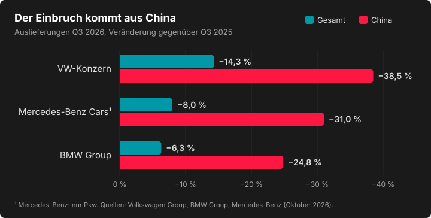

Am **24. Oktober 2025** meldete Porsche fast eine Milliarde Euro operativen Verlust in einem einzigen Quartal. Wir haben damals gesagt: Die Autoindustrie brennt. Ein Jahr später, in der Woche der neuen Quartalszahlen, haben wir uns selbst überprüft. Hier findet ihr die Zahlen, Grafiken und Quellen zur Folge, auch die, für die im Gespräch keine Zeit war.

> **Stand: 31. Oktober 2026**, mit den Quartalszahlen von Porsche (27.10.), Mercedes-Benz (28.10.), Volkswagen (29.10.) und Audi (30.10.). BMW legt seine Zahlen Anfang November vor.

## Die Woche in einem Satz

Am 27. Oktober meldet Porsche **1,74 Mrd. €** operativen Gewinn für die ersten neun Monate, im Vorjahr waren es 0,04 Mrd. €. Zwei Tage später schreibt der Mutterkonzern Volkswagen **6,4 Mrd. €** auf Porsche ab und macht im dritten Quartal **5,86 Mrd. €** operativen Verlust.

Wie passt das zusammen? Die Abschreibung betrifft den **Firmenwert**, mit dem Porsche in der VW-Bilanz steht. Dieser Wert hängt an den **erwarteten künftigen Gewinnen**. VW erwartet von Porsche heute weniger als früher. Die Abschreibung ist **nicht zahlungswirksam**: Es fließt kein Geld ab. **Ein Unternehmen kann sich erholen und trotzdem weniger wert sein.**

## Ein Jahr später: Hatten wir recht?

| Was wir gesagt haben | Was passiert ist | Urteil |
|---|---|---|
| Die Krise bei Porsche, VW und Mercedes ist ernst (Herbst 2025) | VW Jan.–Sep. 2026: operatives Ergebnis **0,07 Mrd. €** (Vorjahr 5,41 Mrd. €). Audi und Mercedes senken die Prognose | ✔️ richtig |
| Langsame Erholung ab 2026 (Bundesbank-Szenario für die Gesamtwirtschaft) | In der Autoindustrie ist keine Erholung zu sehen | ❌ daneben |
| Porsche zeigt, wie es mit E-Autos und China geht | Porsche-Auslieferungen in China Jan.–Sep. 2026: −33 %, der E-Anteil ist gesunken, VW schreibt auf Porsche ab | ❌ daneben |
| 50.000 Stellen bei VW sind erst der Anfang | Der Zukunftsplan 2030 bringt rund 50.000 weitere Stellen weltweit, davon 12.000 zusätzlich bei der Kernmarke | ✔️ richtig |

**Was wir nicht kommen sahen:** Porsche verdient wieder. Weniger Autos, mehr Marge.

## Porsche: Erholung mit Sternchen

| Porsche, Januar bis September | 2025 | 2026 |
|---|---|---|
| Umsatz | 26,86 Mrd. € | 25,28 Mrd. € |
| Operatives Ergebnis | 0,04 Mrd. € | 1,74 Mrd. € |
| Operative Umsatzrendite | 0,2 % | 6,9 % |
| Kosten der Neuausrichtung | rund 2,7 Mrd. € | rund 0,5 Mrd. € |
| Auslieferungen | 212.509 | 178.532 (−16,0 %) |
| Anteil reiner E-Autos | 23,1 % | 21,7 % |
| Netto-Cashflow Automobile | 1,34 Mrd. € | 2,50 Mrd. € |

Zwei Sternchen gehören dazu:

1. **Der Sprung kommt vor allem von den Umbaukosten.** 2025 kostete die Neuausrichtung rund 2,7 Mrd. €, 2026 bisher rund 0,5 Mrd. €. Rechnet man diese Kosten heraus, lag das operative Ergebnis 2025 bei rund 2,7 Mrd. € und 2026 bei rund 2,2 Mrd. €, also etwa **18 % niedriger** (unsere Rechnung mit den gerundeten Porsche-Angaben).
2. **Im Cashflow steckt ein Verkauf.** Porsche hat im September seine Anteile an Bugatti Rimac und der Rimac Group verkauft. Das brachte **984 Mio. €** Geld, das laut Porsche „im Wesentlichen“ in den Netto-Cashflow Automobile eingeflossen ist. Der Buchgewinn von 593 Mio. € steckt im Finanzergebnis, nicht im operativen Ergebnis.

Die Prognose für 2026 hat Porsche bestätigt: 35 bis 36 Mrd. € Umsatz und **5,5–7,5 %** operative Rendite. Die US-Zölle kosteten Porsche allein im dritten Quartal rund 200 Mio. € Cashflow.

## Die Zahlen der Woche

| 3. Quartal 2026 | Umsatz | Ergebnis | Prognose 2026 |
|---|---|---|---|
| **VW-Konzern** | 75,3 Mrd. € (−6,3 %) | operativ −5,86 Mrd. € (Vorjahr −1,30 Mrd. €), nach Steuern −5,82 Mrd. € | operative Rendite bis zu 1 % (bis 18.09.: 4,0–5,5 %) |
| **Audi-Konzern** | 12,9 Mrd. € (−18,5 %) | operativ rund 28 Mio. € (Vorjahr 468 Mio. €)¹, nach Steuern 95 Mio. € | 3–5 % (im Juli: 5–7 %) |
| **Mercedes-Benz** | 30,7 Mrd. € (Vorjahr 32,1 Mrd. €) | EBIT 1,77 Mrd. € (Vorjahr 0,75 Mrd. €), bereinigt 1,78 Mrd. € (−15 %) | Pkw-Rendite 2–3 % (zuvor 3–5 %) |

*¹ Audi weist das dritte Quartal nicht einzeln aus. Wir haben es aus den Audi-Angaben für das erste Halbjahr (1.122 Mio. €) und die ersten neun Monate (1.150 Mio. €) errechnet. Einige Medien nennen 29 Mio. €, der Unterschied kommt von der Rundung.*

*Erwartete operative Umsatzrendite 2026. Bei Mercedes-Benz ist es die bereinigte Rendite der Pkw-Sparte. Die Werte stehen auch in der Tabelle.*

Was hinter den Zahlen steckt:

- **VW:** Von den Sondereffekten in Höhe von **7,8 Mrd. €** im dritten Quartal entfallen 6,4 Mrd. € auf den Porsche-Firmenwert und rund 1 Mrd. € auf Abschreibungen bei Gesellschaften in China. Dazu kommen Kosten für den geplanten Verkauf des Werks Osnabrück. Vor Sondereffekten lag die operative Rendite von Januar bis September bei 3,8 %. Finanzvorstand Arno Antlitz: „Das ist zu wenig, um weiter kraftvoll in unsere Zukunft zu investieren.“
- **VW ist nicht pleite:** Der Netto-Cashflow im Autogeschäft lag von Januar bis September bei 4,4 Mrd. €, die Nettoliquidität bei 33 Mrd. €.
- **Mercedes-Benz:** Das höhere EBIT ist ein Basiseffekt, weil das Vorjahresquartal hohe Sonderbelastungen hatte. Bereinigt sinkt das Ergebnis. Der Free Cashflow des Industriegeschäfts fiel auf 172 Mio. € (Vorjahr 1.367 Mio. €). Lichtblick: ein Rekord bei reinen E-Autos.
- **Audi:** Die Auslieferungen der Marke Audi sanken im dritten Quartal um 19,7 % auf 314.905 Autos, in China von Januar bis September um 24,5 %.

## Der Einbruch kommt aus China

*Auslieferungen im 3. Quartal 2026 gegenüber dem Vorjahresquartal. Die Werte stehen auch in der Tabelle.*

| Q3 2026 | Gesamt | China |
|---|---|---|
| VW-Konzern | 1,885 Mio. (−14,3 %) | 405.800 (−38,5 %) |
| Mercedes-Benz Cars (nur Pkw) | 407.232 (−7,8 %) | 86.800 (−31 %) |
| BMW Group | 551.072 (−6,3 %) | 114.355 (−24,8 %) |

Ohne China hätte der VW-Konzern im dritten Quartal nur **3,8 %** verloren. Der chinesische Pkw-Markt selbst ist laut CAM von Januar bis September um **21,7 %** geschrumpft.

## Der VW-Zukunftsplan 2030 und der Tarifkonflikt

Der Aufsichtsrat hat den Plan am **3. September 2026** einstimmig gebilligt:

- **rund 50.000 weitere Stellen weltweit**, zusätzlich zu den rund 50.000 bereits vereinbarten in Deutschland (zusammen etwa 100.000 bis 2030, unsere Addition)
- **9 %** operative Rendite als Ziel bis 2030, ein Sparprogramm von rund **31 Mrd. €**
- **halb so viele Modelle** bis 2035
- **500.000 Fahrzeuge Überkapazität** in Europa
- **Emden, Zwickau, Hannover und Neckarsulm** haben keine gesicherte Folgeproduktion, wenn die heutigen Modelle 2031 bis 2034 auslaufen. Ein Konzept soll bis Ende Juni 2027 stehen. **Geschlossen ist nichts.**

Seitdem hat sich der Ton verschärft:

- **23. Oktober:** Bei der Kernmarke sollen bis 2030 **weitere 12.000 Stellen** sozialverträglich wegfallen, zusätzlich zu den bereits angekündigten mehr als 35.000.
- VW hat **zehn Tarifverträge** zum 31. Dezember 2026 gekündigt. Damit endet auch die **Friedenspflicht**. Die nächsten Tarifgespräche sind am 24. November in Emden und am 15. Dezember in Zwickau.
- Für die IG Metall ist das ein „tarifpolitischer Wortbruch“. An der Beschäftigungssicherung bis Ende 2030 hält VW laut dpa fest.
- Das **Werk Osnabrück** (rund 2.300 Beschäftigte) soll verkauft werden. Eine Entscheidung wird bis Ende 2026 erwartet.

## Was das für die Region heißt

- **Audi Neckarsulm:** mehr als 15.000 Beschäftigte, dazu rund 1.000 Zulieferunternehmen. Die Beschäftigungssicherung läuft bis Ende 2033; laut einem internen Papier, über das die WirtschaftsWoche berichtet, endet die Produktion 2034. Am 9. Oktober hat Audi die „Schlechtwetterklausel“ gezogen, die Verhandlungen über Sparmaßnahmen vorschreibt. Mit rund 28 Mio. € operativem Ergebnis im dritten Quartal steigt der Druck.
- **Porsche (Zuffenhausen und Weissach):** weitere 5.000 Stellen bis 2035, sozialverträglich; Standortsicherung bis Ende 2035 und 2,1 Mrd. € Investitionen.
- **Mercedes-Benz:** Ab Dezember 2026 startet ein neues freiwilliges Abfindungsprogramm für indirekte Bereiche in Deutschland.

## Audi in Georgia: Standortentscheidung und Streit

Am **24. Oktober** hat US-Präsident Trump bei einer Wahlkampfveranstaltung in **Perry, Georgia**, das erste Audi-Werk in den USA angekündigt. Audi-Chef Gernot Döllner stand mit auf der Bühne.

- **Das Werk:** Standort **Macon, Georgia**, rund 4 Mrd. US-$, bis zu 200.000 SUVs pro Jahr, etwa 4.500 Arbeitsplätze, Baubeginn 2027.
- **Noch offen:** Der VW-Aufsichtsrat muss zustimmen. Ob es Zusagen bei den Zöllen gibt, ist unklar.
- **Die Kritik:** IG Metall, VW-Betriebsrat und Politiker aus Baden-Württemberg und Niedersachsen kritisieren den Auftritt kurz vor den US-Kongresswahlen. Mehrere Kritiker halten die Investition selbst trotzdem für nachvollziehbar.
- **Die Antwort:** Döllner hat den Auftritt in einem internen Schreiben verteidigt. Er sei im Interesse des Unternehmens gewesen, eine Produktion in den USA sei strategisch wichtig. Er räumt ein, dass der Rahmen als politisches Signal verstanden wurde.

Wir bewerten den Auftritt nicht politisch. Für die Region zählt: Die neuen Audi-SUVs für Amerika sollen in Amerika gebaut werden, und für Neckarsulm fehlt weiterhin eine gesicherte Folgeproduktion.

## Faktencheck: Was belegt ist und was nicht

Rund um die Autoindustrie kursieren viele Zahlen. So haben wir sie eingeordnet:

| Behauptung | Einordnung |
|---|---|
| „VW hat 6,4 Milliarden Euro verloren“ | **Irreführend.** Die Abschreibung auf Porsche ist nicht zahlungswirksam. Der operative Verlust im dritten Quartal ist real, das Geld fließt aber nicht ab. |
| „Porsche hat die Krise hinter sich“ | **Zu früh.** Der Gewinn steigt vor allem, weil der Umbau weniger kostet. Die Auslieferungen sinken um 16 %. |
| „Audi schreibt rote Zahlen“ | **Für den Audi-Konzern falsch:** knapp im Plus. Berichte über einen Verlust beziehen sich auf die Marke Audi allein, ohne Lamborghini, Bentley und Ducati. |
| „VW streicht 100.000 Stellen“ | **Rechnerisch plausibel:** rund 50.000 in Deutschland plus rund 50.000 weltweit. VW selbst nennt keine Gesamtzahl. |
| „VW schließt vier Werke“ | **Falsch.** Keine Schließung ist beschlossen; es fehlt eine gesicherte Folgeproduktion. Osnabrück soll verkauft werden. |
| „BMW baut 8.000 Stellen ab“ | **Unbestätigt.** Medienbericht (dpa, „Unternehmenskreise“), BMW hat keine Zahl genannt. |
| „BMW zahlt bis zu 650.000 € Abfindung“ | **Unbestätigt.** Laut Handelsblatt in Einzelfällen, aus einem internen Dokument. |
| „China schrumpft um 21,7 %“ | **Stimmt für den chinesischen Pkw-Markt** (CAM, Jan.–Sep.), nicht für einzelne Hersteller. |

## Quellen

**Unternehmen**

- [Porsche Newsroom: Finanzergebnisse Januar bis September 2026 (27.10.2026)](https://newsroom.porsche.com/de/2026/unternehmen/porsche-finanzen-q3-2026-43486.html)
- [Volkswagen Group: Neunmonats-Ergebnis unterstreicht sofortigen Handlungsdruck (29.10.2026)](https://www.volkswagen-group.com/de/pressemitteilungen/volkswagen-group-neunmonats-ergebnis-unterstreicht-sofortigen-handlungsdruck-20799)
- [Volkswagen Group: Auslieferungen bis September 2026](https://www.volkswagen-group.com/de/pressemitteilungen/volkswagen-group-liefert-bis-september-6-millionen-fahrzeuge-aus-rund-40-prozent-des-auftragsbestands-in-europa-sind-vollelektrische-modelle-20737)
- [Audi: Herausfordernde erste neun Monate (30.10.2026)](https://www.audi.com/de/medieninformationen/herausfordernde-erste-neun-monate-audi-verschaerft-massnahmen-zur-steigerung-der-wettbewerbsfaehigkeit-18427)
- [Audi: Erstes Halbjahr 2026 (27.07.2026)](https://www.audi.com/de/pressemitteilungen/audi-konzern-haelt-operatives-ergebnis-im-ersten-halbjahr-2026-trotz-schwieriger-maerkte-stabil-18148)
- [Mercedes-Benz Group: Q3 2026 (28.10.2026)](https://media.mercedes-benz.com/article/300f16c7-24b3-4f6c-a00b-a037d8049c4f)
- [EY: Analyse der Automotive-Bilanzen, erstes Halbjahr 2026](https://www.ey.com/de_de/newsroom/2026/09/ey-analyse-automotive-bilanzen-q2-2026)

**Berichte**

- [Handelsblatt: Porsche tief in der Krise (24.10.2025)](https://www.handelsblatt.com/unternehmen/industrie/autohersteller-porsche-tief-in-der-krise-fast-eine-milliarde-euro-quartalsverlust/100165910.html)
- [Stuttgarter Zeitung: VW senkt Gewinnprognose (18.09.2026)](https://www.stuttgarter-zeitung.de/wirtschaft/krise-in-der-autoindustrie-volkswagen-senkt-gewinnprognose-milliarden-abschreibung-auf-porsche-79483175.html)
- [Handelsblatt: Audi im dritten Quartal (30.10.2026)](https://www.handelsblatt.com/unternehmen/industrie/autohersteller-audi-schreibt-verluste-im-dritten-quartal/100265268.html)
- [bmwblog: BMW Q3 2026](https://www.bmwblog.com/2026/10/13/bmw-global-sales-q3-2026/)
- [Dr. Web: VW-Auslieferungen Q3 2026](https://www.drweb.de/vw-auslieferungen-q3-2026-china/)
- [tuningblog: CAM-Analyse Januar bis September 2026](https://www.tuningblog.eu/kredit-finanzierung-leasing-co/autohersteller-absatztrends-2026-809170)
- [ecomento: VW-Zukunftsplan 2030 (04.09.2026)](https://ecomento.de/2026/09/04/volkswagen-zukunftsplan-2030-weniger-modelle-weniger-personal-neue-werkestruktur/)
- [auto motor und sport: Diese VW-Werke stehen zur Disposition (02.09.2026)](https://www.auto-motor-und-sport.de/verkehr/vw-plant-produktionsende-an-vier-standorten-diese-vw-werke-sollen-bis-2034-schliessen/)
- [t-online: Volkswagen will 12.000 weitere Stellen abbauen (23.10.2026)](https://www.t-online.de/finanzen/aktuelles/wirtschaft/id_101495606/volkswagen-will-12000-weitere-stellen-abbauen.html)
- [MM Maschinenmarkt: IG Metall warnt vor heißem Tarifwinter (26.10.2026)](https://www.maschinenmarkt.vogel.de/vw-sparplaene-ig-metall-tarifwinter-stellenabbau-a-b4915717a12a5b07108f7fd369ce1296/)
- [MM Maschinenmarkt: Rheinmetall sagt Übernahme von Osnabrück ab](https://www.maschinenmarkt.vogel.de/rheinmetall-absage-vw-werk-osnabrueck-a-7e93165d33dc7b525212d4e7e7a95ded/)
- [autohaus.de: Audi zieht die Schlechtwetterklausel (09.10.2026)](https://www.autohaus.de/nachrichten/autohersteller/audi-zieht-schlechtwetterklausel-weiterer-stellenabbau-in-neckarsulm-3915070)
- [electrive: Porsche baut weitere 5.000 Arbeitsplätze ab (28.07.2026)](https://www.electrive.net/2026/07/28/porsche-baut-weitere-5-000-arbeitsplaetze-ab/)
- [Handelsblatt: Tausende wollen BMW verlassen](https://www.handelsblatt.com/unternehmen/industrie/autobauer-tausende-wollen-bmw-verlassen-abfindungsprogramm-geschlossen/100263648.html)
- [ZDFheute: Audi will Werk in den USA bauen](https://www.zdfheute.de/wirtschaft/unternehmen/audi-usa-trump-doellner-auto-100.html)
- [autohaus.de: Döllner rechtfertigt Auftritt mit Trump](https://www.autohaus.de/nachrichten/politik/nach-kritik-audi-chef-doellner-rechtfertigt-auftritt-mit-trump-3927184)
- [CNBC: Audi plant in Georgia (24.10.2026)](https://www.cnbc.com/2026/10/24/trump-audi-factory-georgia.html)

---

*Persönliche Sicht der Hosts, keine Anlage-, Rechts- oder Abfindungsberatung.*
