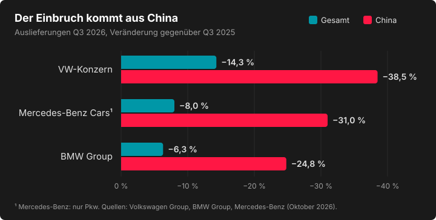

Am **24. Oktober 2025** meldete Porsche fast eine Milliarde Euro operativen Verlust in einem einzigen Quartal. Wir haben damals gesagt: Die Autoindustrie brennt. Ein Jahr später haben wir uns selbst überprüft. Hier findet ihr die Zahlen, Grafiken und Quellen zur Folge, auch die, für die im Gespräch keine Zeit war.

> **Stand: 26. Oktober 2026.** Porsche (27.10.) und Mercedes-Benz (28.10.) legen in diesen Tagen neue Quartalszahlen vor. Wir ergänzen sie hier.

## Ein Jahr später: Hatten wir recht?

| Was wir gesagt haben | Was passiert ist | Urteil |
|---|---|---|
| Die Krise bei Porsche, VW und Mercedes ist ernst (Herbst 2025) | Der operative Gewinn von VW, Mercedes und BMW sinkt im ersten Halbjahr 2026 um 19 %, während die 19 größten Autokonzerne weltweit um 11,4 % zulegen | ✔️ richtig |
| Langsame Erholung ab 2026 (Bundesbank-Szenario für die Gesamtwirtschaft) | In der Autoindustrie ist keine Erholung zu sehen | ❌ daneben |
| Porsche zeigt, wie es mit E-Autos und China geht | Porsche-Auslieferungen in China Jan.–Sep. 2026: −33 %, der E-Anteil ist gesunken | ❌ daneben |
| 50.000 Stellen bei VW sind erst der Anfang | Der Zukunftsplan 2030 bringt rund 50.000 weitere Stellen weltweit | ✔️ richtig |

**Was wir nicht kommen sahen:** Porsche verdient wieder. Die operative Umsatzrendite lag im ersten Halbjahr 2026 bei **7,8 %** (Vorjahr 5,5 %), obwohl die Auslieferungen bis September um **16 %** gesunken sind. Weniger Autos, mehr Marge.

## Der Einbruch kommt aus China

*Auslieferungen im 3. Quartal 2026 gegenüber dem Vorjahresquartal. Die Werte stehen auch in der Tabelle.*

| Q3 2026 | Gesamt | China |
|---|---|---|
| VW-Konzern | 1,885 Mio. (−14,3 %) | 405.800 (−38,5 %) |
| Mercedes-Benz Cars (nur Pkw) | 407.200 (−8 %) | 86.800 (−31 %) |
| BMW Group | 551.072 (−6,3 %) | 114.355 (−24,8 %) |

Ohne China hätte der VW-Konzern im dritten Quartal nur **3,8 %** verloren. In Europa wachsen alle drei leicht. Der chinesische Pkw-Markt selbst ist laut CAM von Januar bis September um **21,7 %** geschrumpft.

## Der VW-Zukunftsplan 2030 in Zahlen

Der Aufsichtsrat hat den Plan am **3. September 2026** einstimmig gebilligt:

- **rund 50.000 weitere Stellen weltweit**, zusätzlich zu den rund 50.000 bereits vereinbarten in Deutschland (zusammen etwa 100.000 bis 2030, unsere Addition)
- **9 %** operative Rendite als Ziel bis 2030 (erstes Halbjahr 2026: 3,8 %)
- **halb so viele Modelle** bis 2035
- **135 Mrd. €** für Sachinvestitionen und Forschung 2027–2031
- **500.000 Fahrzeuge Überkapazität** in Europa
- **Emden, Zwickau, Hannover und Neckarsulm** haben keine gesicherte Folgeproduktion, wenn die heutigen Modelle 2031 bis 2034 auslaufen. Ein Konzept soll bis Ende Juni 2027 stehen. **Geschlossen ist nichts.**

## Was das für die Region heißt

- **Audi Neckarsulm:** mehr als 15.000 Beschäftigte, dazu rund 1.000 Zulieferunternehmen. Die Beschäftigungssicherung läuft bis Ende 2033; laut einem internen Papier, über das die WirtschaftsWoche berichtet, endet die Produktion 2034. Am 9. Oktober hat Audi die „Schlechtwetterklausel“ gezogen, die Verhandlungen über Sparmaßnahmen vorschreibt.
- **Porsche (Zuffenhausen und Weissach):** weitere 5.000 Stellen bis 2035, sozialverträglich; Standortsicherung bis Ende 2035 und 2,1 Mrd. € Investitionen.
- **Gleichzeitig:** Audi kündigt am 24. Oktober sein erstes Werk in den USA an (Georgia, rund 4 Mrd. US-$, bis zu 200.000 SUVs pro Jahr). Der VW-Aufsichtsrat muss noch zustimmen.

## Faktencheck: Was belegt ist und was nicht

Rund um die Autoindustrie kursieren viele Zahlen. So haben wir sie eingeordnet:

| Behauptung | Einordnung |
|---|---|
| „VW streicht 100.000 Stellen“ | **Rechnerisch plausibel:** rund 50.000 in Deutschland plus rund 50.000 weltweit. VW selbst nennt keine Gesamtzahl. |
| „VW schließt vier Werke“ | **Falsch.** Keine Schließung ist beschlossen; es fehlt eine gesicherte Folgeproduktion. |
| „BMW baut 8.000 Stellen ab“ | **Unbestätigt.** Medienbericht (dpa, „Unternehmenskreise“), BMW hat keine Zahl genannt. |
| „BMW zahlt bis zu 650.000 € Abfindung“ | **Unbestätigt.** Laut Handelsblatt in Einzelfällen, aus einem internen Dokument. |
| „Mercedes erwartet 2 bis 7,5 % weniger Absatz“ | **Nicht belegt.** Die Prognose lautet seit Juli „leicht unter Vorjahr“. |
| „China schrumpft um 21,7 %“ | **Stimmt für den chinesischen Pkw-Markt** (CAM, Jan.–Sep.), nicht für einzelne Hersteller. |

## Quellen

**Unternehmen und Studien**

- [Porsche Newsroom: Finanzergebnisse erstes Halbjahr 2026](https://newsroom.porsche.com/de_CH/2026/unternehmen/porsche-finanzergebnisse-erstes-halbjahr-2026-42949.html)
- [Volkswagen Group: Auslieferungen bis September 2026](https://www.volkswagen-group.com/de/pressemitteilungen/volkswagen-group-liefert-bis-september-6-millionen-fahrzeuge-aus-rund-40-prozent-des-auftragsbestands-in-europa-sind-vollelektrische-modelle-20737)
- [EY: Analyse der Automotive-Bilanzen, erstes Halbjahr 2026](https://www.ey.com/de_de/newsroom/2026/09/ey-analyse-automotive-bilanzen-q2-2026)

**Berichte**

- [Handelsblatt: Porsche tief in der Krise (24.10.2025)](https://www.handelsblatt.com/unternehmen/industrie/autohersteller-porsche-tief-in-der-krise-fast-eine-milliarde-euro-quartalsverlust/100165910.html)
- [bmwblog: BMW Q3 2026](https://www.bmwblog.com/2026/10/13/bmw-global-sales-q3-2026/)
- [auto motor und sport: Mercedes Q3 2026](https://www.auto-motor-und-sport.de/verkehr/mercedes-nennt-neue-quartalszahlen-der-absturz-geht-weiter/)
- [Dr. Web: VW-Auslieferungen Q3 2026](https://www.drweb.de/vw-auslieferungen-q3-2026-china/)
- [tuningblog: CAM-Analyse Januar bis September 2026](https://www.tuningblog.eu/kredit-finanzierung-leasing-co/autohersteller-absatztrends-2026-809170)
- [ecomento: VW-Zukunftsplan 2030 (04.09.2026)](https://ecomento.de/2026/09/04/volkswagen-zukunftsplan-2030-weniger-modelle-weniger-personal-neue-werkestruktur/)
- [auto motor und sport: Diese VW-Werke stehen zur Disposition (02.09.2026)](https://www.auto-motor-und-sport.de/verkehr/vw-plant-produktionsende-an-vier-standorten-diese-vw-werke-sollen-bis-2034-schliessen/)
- [autohaus.de: Audi zieht die Schlechtwetterklausel (09.10.2026)](https://www.autohaus.de/nachrichten/autohersteller/audi-zieht-schlechtwetterklausel-weiterer-stellenabbau-in-neckarsulm-3915070)
- [electrive: Porsche baut weitere 5.000 Arbeitsplätze ab (28.07.2026)](https://www.electrive.net/2026/07/28/porsche-baut-weitere-5-000-arbeitsplaetze-ab/)
- [Handelsblatt: Tausende wollen BMW verlassen](https://www.handelsblatt.com/unternehmen/industrie/autobauer-tausende-wollen-bmw-verlassen-abfindungsprogramm-geschlossen/100263648.html)
- [CNBC: Audi plant in Georgia (24.10.2026)](https://www.cnbc.com/2026/10/24/trump-audi-factory-georgia.html)

---

*Persönliche Sicht der Hosts, keine Anlage-, Rechts- oder Abfindungsberatung.*
